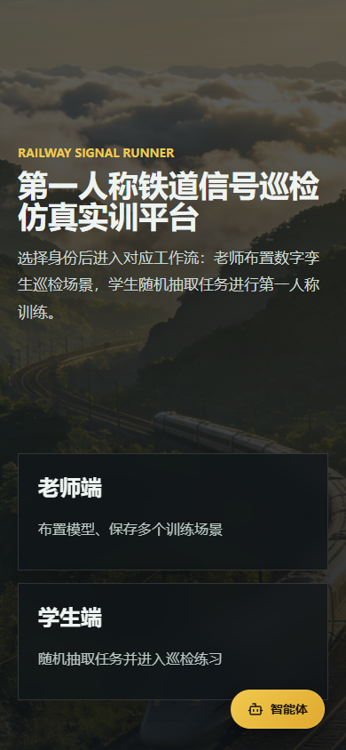
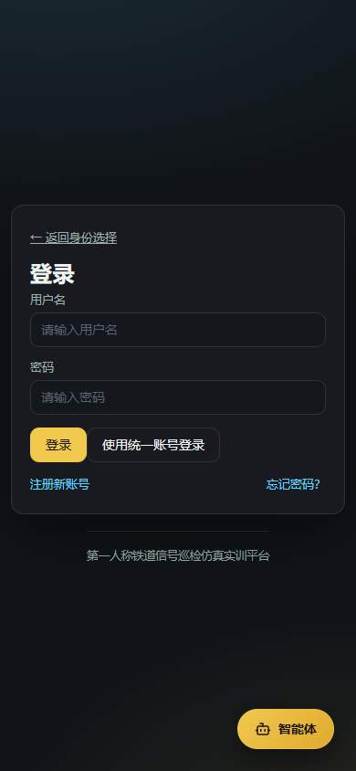
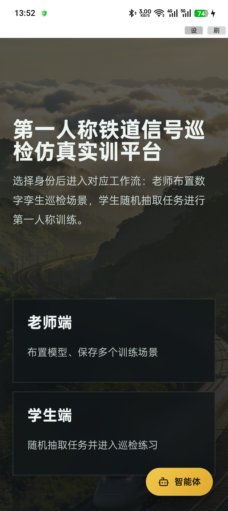
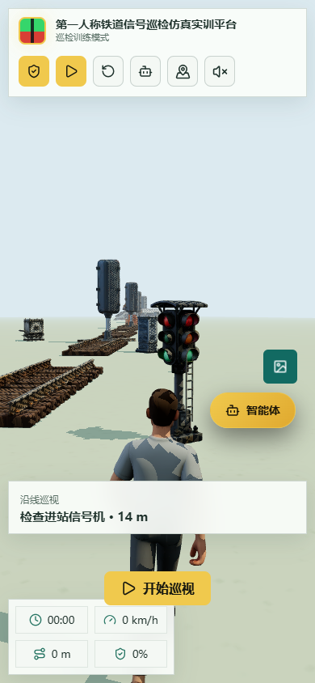

# 第一人称铁道信号巡检仿真实训平台

版本号：V1.0

用户手册

## 目录

1. 使用前提与角色说明
2. 入口与角色选择（适用角色：学生、教师）
3. 账号与登录（适用角色：账号用户）
4. 教师场景编辑（适用角色：教师、管理员）
5. 学生默认实训（适用角色：学生）
6. 设备智能助手（适用角色：已登录学生、教师）
7. 管理台操作（适用角色：管理员）
8. 异常处理与数据保护
9. 验收范围与结论

## 1. 使用前提与角色说明

### 1.1 手册边界

本手册依据当前版本实际运行的 Web 页面编写。它说明默认实训场、场景布置、浏览器存储、授权教师的云端保存、近设备提问、账号及管理栏目。人物和沿线设备采用本项目已有的 GLB 模型；参考平台的看板只用于观察游览视角与亮色布局，未把第三方人物资产复制进项目。软件用于教学模拟，不会控制真实轨道信号。

当前应用封面/页眉暂用“第一人称铁道信号巡检仿真实训平台 V1.0”；场景默认训练改为背向镜头的第三人称游览视角，正式产品名称及登记版本由申请人确认。图中的测试账号、场景时间和模型名称仅对应本次运行环境，不能据此推断其他机器已安装同样模型。

### 1.2 设备和服务前提

在支持 WebGL 的现代浏览器打开 `http://***:4029/`。训练画布依赖 Three.js/GLTFLoader 和设备图形性能；Cesium 小地图依赖地图资源。离线或未登录时，可在当前浏览器读取默认本地实训场，并由教师本地编辑/导出 JSON；需要 PostgreSQL 场景、管理员台或 AI 问答时，还必须连接 API、数据库并登录适当身份。默认实训场在浏览器首次进入和服务端启动时均按固定 ID 仅在缺失时建立，已有教师保存版本不会被种子覆写。

| 身份或状态 | 可直接做的事 | 额外前提 |
| --- | --- | --- |
| 匿名访客 | 身份选择、默认学生训练、本地教师编辑 | 教师按钮不赋予服务器 teacher 权限 |
| student | 浏览器训练、账户页、经允许的 AI 提问 | 需要账号登录，不能使用管理员接口 |
| teacher | 编辑本地场景并同步云端、发布/下架 | 后端账户角色需为 teacher |
| admin | 管理台、模型管理及教师云端保存 | 后端账户角色需为 admin |

### 1.3 图片与操作约定

截图均来自当前软件的真实浏览器或 Android 运行状态；账户表格和输入栏如涉及个人字段已在截图中遮蔽。图题的（a）表示入口或主要操作，（b）表示操作后的页面或同功能的第二个真实状态。按钮标签和字段名均取自当前界面。输入框中的示例名称、时间或测试回复会随数据库与部署环境变化，不应把它们写作固定操作结果。

## 2. 入口与角色选择（适用角色：学生、教师）

### 2.1 打开首页

图 2-1（a）首页角色入口；（b）需要账号时的登录入口。打开首页后选“老师端”进入三维布置，选“学生端”进入已发布场景列表；如果需要在线管理员能力，使用登录页完成真正的账户验证。首页卡片不替服务器开通 teacher/admin 角色。教师和学生端即使浏览器没有后端也可显示本地页面，但登录、在线保存及 AI 不能在断网时正常工作。

### 2.2 身份卡片与账户角色的区别

老师端入口是打开 `/#/teacher` 的导航，未登录仍允许放置模型和保存当前浏览器场景。右侧设置栏明确显示“保存位置：当前浏览器”或“保存位置：本地与数据库”；只有后端校验为 teacher/admin 的用户，第二种状态才可用。学生端入口同样是导航，不要求点击前已经登录；但是接近设备后向 AI 提问需要登录，问答才能保存到对应账号。

## 3. 账号与登录（适用角色：账号用户）

### 3.1 注册账户

图 3-1（a）注册资料与身份选择；（b）注册后进入登录/账号使用流程。点“注册新账号”，输入 3–32 位符合规则的用户名、可选显示名和邮箱，在身份栏按管理员开通策略选择；新密码至少 8 位、同时含字母和数字，确认密码必须一致。点击“注册并登录”后，成功则创建账户并自动登录；用户名被占用、密码过弱或请求不允许的角色时会显示失败原因。不能通过修改浏览器表单或请求体自助注册管理员。

### 3.2 普通账号登录及退出

在登录页输入用户名和密码，点“登录”。成功后应在我的账号页看到当前显示名和角色，后续请求会携带访问令牌。登录失败时先核对用户名、密码及账号是否禁用/锁定；连续密码错误会触发临时锁定，不应反复尝试。账户页右上角“退出登录”会清理本机登录态；需要重新操作云端资源时再次登录。当前代码定义的账号角色为学生、教师和管理员，未定义独立的普通用户角色。

### 3.3 找回与修改密码

图 3-2（a）找回密码表单；（b）已登录账号维护页面。忘记密码时在申请页填用户名、邮箱或手机号，提交后按页面提示联系管理员取得一次性重置链接。平台当前不提供自动电子邮件或短信投递；出现“已收到请求”不代表邮件已经发送。链接过期或被使用后需重新申请。

已登录时进入“我的账号”，可维护显示名称、邮箱和手机号。修改密码需输入当前密码、新密码和确认值，前端显示长度及字符规则；成功后服务端吊销该用户的刷新令牌，本机也必须重新登录。账户页还可查看自己的智能体会话列表；若模型服务不可用，该页账号资料仍可操作，不应与聊天可用性混淆。

### 3.4 可选统一身份

登录页可能出现“使用统一账号登录”，账户页可能出现“绑定统一账号”。只有系统管理员已经配置 OIDC 身份服务与允许的回调地址，相关按钮才可能完成跳转和绑定。初次使用需先有本地账号再按流程关联，系统不会仅因用户名或邮箱相同就自动合并账户。统一身份服务失败时回到本地登录并咨询维护人员，不应把失败链接反复用于登录。

## 4. 教师场景编辑（适用角色：教师、管理员）

### 4.1 打开默认场景并辨认工作区

图 4-1（a）教师进入后自动载入站场示范场；（b）选中设备后出现位姿与巡检任务设置。右侧为铁路构件库及“场景名称/说明/难度/时长/发布给学生”，左侧为对象属性和变换模式；中部是完整三维场景，GIS 小地图为位置参考。默认示范场有 13 个对象、7 个巡检点，包括信号机、道岔、转辙机、设备箱、应答器、站台和人物。加载只在场景固定 ID 缺失时播种，不清除教师已保存的版本。

### 4.2 增加设备和调整位置

先选右侧类别，再点击设备卡片或把卡片拖到场景中。新对象选中后，左侧可使用“移动”“旋转”“缩放”模式和前后左右移动按钮；位姿栏用 X/Y/Z 录入具体数值，旋转栏显示角度，缩放不可填写无效数值。每次操作观察模型和对象属性是否对应，避免把设备布置到站台、轨道或已有对象内部。点击“删除”仅移除当前对象，“清空”需确认后移除当前场景所有模型；这些操作在保存前主要影响当前画布状态。

### 4.3 设置巡检目标及任务

选中希望学生检查的设备，确认“设为学生巡检点”状态。填写任务标题、任务说明、故障类型、分值和提示；如无任务标题，系统会按设备名生成“检查某设备”的默认标题。任务值会序列化到对象 `task` 和场景 `tasks`。当前训练运行规则是**接近目标后自动标记已巡视**，这些故障类型与分值字段不会在本版本自动变成诊断选择题或自动计分页；不能在手册里引导学生寻找尚不存在的答题按钮。

### 4.4 发布、本地保存和数据库保存

填写场景名称与难度，勾选“发布给学生”，确认场景中至少存在一个巡检点，然后点击顶部“保存场景”。点击后浏览器会提供 JSON 下载，随后写当前浏览器 IndexedDB；如果当前登录角色是 teacher/admin，页面还会请求云端 PostgreSQL 场景接口并设置发布状态。右侧“保存位置”提示当前身份的保存范围：匿名为“当前浏览器”，授权身份为“本地与数据库”。云端写入失败时页面应显示“本地已保存，云端未保存”，需检查账号、API 和数据库后再重试；不能把 JSON 文件出现当作数据库保存成功。

默认示范场使用固定 ID。管理员或教师修改后再次保存是对同 ID 更新；服务器下次启动的幂等种子不会覆盖已保存版本。其他新建场景使用生成的新 ID，删除或误导入文件不应默默替换原示范场。

### 4.5 导入场景文件与本地恢复

点顶部“加载场景”，选择先前导出的 JSON，等待模型载入并核对右侧场景名称和左侧对象数。文件需要包含 `objects` 数组，每个对象需要 `catalogKey`；结构不符合要求时应显示错误，现有场景文件建议保留备份。导入文件后应检查发布状态和任务点，重新保存才会形成新的本地场景 ID；若需要云端版本，先确认使用经授权的教师或管理员身份。

### 4.6 编辑异常与处理

如果模型卡片显示缩略图失败，可检查该 GLB 是否仍在模型目录。个别模型资源加载失败时三维画面可能使用替代对象，并给出提示；不要把替代对象当成原始设备已经正确显示。场景为空而选择发布会被拦截。保存失败先区分本地写入失败与云端接口失败：前者检查浏览器存储权限和空间，后者检查登录角色、服务健康和目标场景归属。

## 5. 学生默认实训（适用角色：学生）

### 5.1 进入默认训练任务

图 5-1（a）学生任务列表中的“默认实训”卡片；（b）点“进入默认实训”后的站场画面。学生点首页“学生端”后，系统先检查浏览器本地默认场景是否存在，同时尝试读取已发布的云端列表；相同 ID 的云端资料优先。默认场景会排在任务列表前方，右上方可点“进入默认实训”；其他已发布场景卡片有“进入练习”，列表中有多个场景时还可用“随机练习”。若后端不可用，浏览器仍可载入本地默认场；但不能因此声称其他设备能看到教师在当前浏览器保存的私有草稿。

如果从云端载入场景，训练页先读取已发布场景的完整 payload；网络故障则回退当前浏览器相同 ID 的数据。加载期间页面显示状态，只有画布就绪才可开始。默认场景中有 13 个真实模型对象和 7 个巡检点，场景名称、对象数量和模型会随教师保存后的版本变化。

### 5.2 辨认训练画面与角色

默认画面采用亮色日光背景，人物背向镜头位于轨道前景，路线上有信号机、道岔、转辙机、设备箱、桥梁和站台。人物来自本项目现有的 `man.glb`，沿线还放有检修人员；不是从参考看板下载的第三方模型。左上目标区显示 `0/7` 等巡检进度，右上 GIS 小地图给出位置参考；底部状态显示时间、速度、里程与目标方向。画面中央的“开始巡视”按钮只在准备状态显示。设备模型位置和小地图仅用于模拟教学，不能据截图推导真实线路的地理坐标或现场设备状态。

### 5.3 开始、转向与移动

点“开始巡视”进入运行，顶部按钮随后变为“暂停”。桌面设备使用 W/S 前后、A/D 左右，Q/E 调整方向，鼠标指针锁定后可转动镜头；Shift 为加速。移动设备在运行中显示方向键，未开始时不占据“开始巡视”按钮位置。走动时观察下方距离和左侧当前目标，避免只盯着地图忽略画面中的设备；需要恢复默认起点时点“重置”，会清空本次计时/里程/已巡视状态。前后左右键盘动作不在输入 AI 问题时使用。

### 5.4 接近目标与自动巡视

图 5-2（a）接近进站信号机时出现设备名称、距离和“询问这台设备”；（b）点击后助手显示“当前设备”。在距巡检点约 14 场景单位内，右侧出现设备卡片；卡片提供任务说明和提问入口。进入约 8 单位范围时，当前版本会自动标记该巡检点已巡视，左侧数量与目标状态随之更新；**当前并没有手动判故障选项，也不会依据教师填写的 score 自动打分**。标记完成后，在靠近范围内仍可继续向助手提问，不会因状态已完成而隐藏设备入口。

未登录时点击设备提问会先提示登录，并带回当前训练页；登录后再接近对应设备即可继续。该动作不是对真实轨道信号灯的诊断结果，也不产生真实设备的维护工单。

### 5.5 全部巡检点和终点

完成所有设备的近距离巡视后，目标引导改为“返抵车站”。还需继续向终点站台移动；只有已巡视数量等于总数且玩家进入终点站台规定距离内，游戏才进入 `completed` 状态，停止本次运行。顶部“重置”可开始新一次训练。没有实测完成全部 7 个点并返回终点的完整截图，本手册不以进度条 100% 的局部画面伪造正式完成证据；实际成绩和数据库记录还需对应版本的专门测试核对。

### 5.6 音效、地图与设备故障提示

顶栏地图图标只切换 GIS 显示，不改变训练空间位置；扬声器图标控制提示音和背景音乐。若模型文件缺失，应用可能使用占位对象并提示；请先检查 GLB 文件及浏览器 WebGL，再重新加载场景。列车靠近路径时可能触发模拟警告与健康值变化，属于游戏规则，不等于真实安全评估。训练时若画面卡顿可暂停，关闭无关标签页再继续；不应通过刷新页面来推断当前运行计时已被完整保存。

## 6. 设备智能助手（适用角色：已登录学生、教师）

### 6.1 打开设备上下文

登录后在训练页移动到目标设备附近，点击右侧“询问这台设备”。助手头部显示当前设备，提问时会发送场景 ID、设备 ID、设备名称和当前任务等上下文；后端将其记录在用户消息的 `scene_context` 与 `equipment_context`。若从顶栏“助手”按钮打开，可询问一般信号知识，但未选择附近设备时不应假装记录了特定设备 ID。离开训练页后场景上下文会清空，避免在其他页面对旧目标提问。

### 6.2 选择模型与发送问题

图 6-1（a）一次使用轻量模型的真实测试问答；（b）管理员视角中的本机模型清单。助手首次读取列表时，若存在可用 DeepSeek，优先选中；否则回退到服务端默认或可用的首个模型。列表中的模型名与运行机器有关，不是软件自带的模型权重。输入设备问题后点“发送”或按 Enter，Shift+Enter 仅换行。模型回复采用流式显示；思考型模型可能先显示等待状态。截图中的测试回复实际由轻量模型生成，不是 DeepSeek 输出；操作前应以弹窗当时的下拉选中项为准。

### 6.3 提问记录、历史会话和中断

发送成功后，消息会出现在当前对话中；后端保存用户问题、模型、设备关联和助手回复，列表内可回看历史会话。点“历史会话”可重新打开旧消息，删除操作会影响当前账号的会话数据，应先确认目标；管理员有独立日志视图可追踪模型、状态和延时，但不能把日志当作完整对话内容。正在生成时可停止，本次未完成的回答不应当作已验证的最终结论。用户仅可按授权范围访问自己的会话，不能把另一个账号的设备记录自动并入本账号。

### 6.4 复制、朗读和语音输入

回复气泡下可点“复制”或“朗读”；朗读依赖浏览器/设备语音合成能力。语音模式可切换关闭、仅朗读和连续对话；麦克风识别需要浏览器安全上下文及授权，Android 原生桥接还需实际客户端和权限支持。当前采集浏览器显示“不支持语音输入”，所以手册只展示文字问答和模式选项，不编造麦克风识别成功的截图。模型回答是教学参考，涉及具体行车规章或设备参数时须核对正式标准。

### 6.5 无模型、网络中断和未登录

下拉没有可用模型时先检查模型服务与管理员模型配置；模型存在但正在加载时等待实际可用状态，不要反复提交同一问题。网络中断可能留下未完成流和错误提示，需先核对历史消息/后台日志再决定是否重试。未登录时设备卡片会跳到登录页面，因为匿名问答无法按账户保存记录；不能通过修改页面按钮绕开服务端身份验证。

## 7. 管理台操作（适用角色：管理员）

### 7.1 进入管理概览

图 7-1 管理概览。用 admin 账号登录后访问 `/admin/dashboard`，侧边栏显示九个管理菜单，主区统计用户、今日登录、训练场景、成绩、AI 会话和模型服务。最近登录表格含登录名、姓名、IP 和时间；交付截图对行数据做遮蔽。概览只读展示统计，不能从卡片数字直接修改业务数据。点击侧边栏可进入对应子路由，返回前台不清除登录态。

### 7.2 用户管理

图 7-2 用户管理。输入用户名/姓名搜索，使用角色和状态筛选，点“刷新”重新查询。表格显示用户名、姓名、角色、状态、邮箱和最近登录，操作栏提供编辑、重置密码、禁用/启用和删除。新建用户需要管理员选择角色并填写资料；重置密码由服务端生成一次性链接或按界面提示处理，不能在截图或手册中记录真实密码。禁用用户后其访问令牌下一次请求由后端拒绝；删除为软删除，历史日志和成绩的外键处理依 schema 规则执行。

### 7.3 训练场景治理

图 7-3（a）场景列表；（b）默认示范场详情。列表可按名称/说明搜索、发布状态筛选和是否包含已删除项过滤，并显示难度、创建者、状态和更新时间。操作栏的“详情”读取完整 payload 只读展示；“发布/下架”调用管理员场景发布接口，“删除”执行软删除，学生列表不再显示。默认示范场由服务启动种子写入、无 owner_id；管理员可以从详情确认模型 payload，但不应在管理台直接编辑其 JSON。

### 7.4 成绩记录

图 7-4 成绩记录。列表按学员、训练场景、完成状态等条件查询，显示得分、检查项、错误数、用时和提交时间；页码和每页条数由分页组件控制。成绩是否存在取决于客户端/服务端实际调用 `POST /api/records`，接近设备的自动巡视本身不保证已经写入一条服务器成绩。管理员可用于查询和审阅，不应从空表推断学生未进行过本地训练。

### 7.5 AI 会话

图 7-5 AI 会话。列表用于按用户、标题、模型、消息数和更新时间查看会话；进入详情可读取消息序列，删除会话会按数据库关系处理消息。设备提问的 `equipment_context` 属于用户消息的持久化字段，管理员查看时要按隐私边界使用，不在截图中暴露测试账号或真实提问内容。会话记录的存在只表示请求已保存，不代表上游模型回复一定完整。

### 7.6 AI 调用日志

图 7-6 AI 调用日志。可以按模型、状态、起止日期筛选，查看首 token、总延迟、输出 token 和时间。失败/中断状态需要结合错误字段排查，不能只用总延迟判断用户体验。截图中的用户和日志字段已脱敏；日志不应被复制到公共材料或作为模型训练数据直接使用。

### 7.7 模型管理

图 7-7 模型管理。页面从后端模型注册表读取本机可见模型，可刷新、加载、卸载或删除模型，也可填写名称发起拉取。删除和拉取是有资源影响的操作，执行前应确认模型名称与磁盘空间；本地测试中模型下拉包含 `deepseek-r1:14b` 和其他 Qwen 模型，但实际可用状态会随 Ollama 运行情况变化。学生助手默认优先选择可用 DeepSeek，不可用时回退。

### 7.8 系统设置

图 7-8 系统设置。页面展示数据库、Ollama、Node 进程、运行时长和只读 `.env` 配置；修改配置必须编辑服务端环境文件并重启 API，不能在页面直接假设已生效。交付截图对主机、配置值和表格字段做遮蔽。`DEV_TEST_LOGIN`、`EXPOSE_RESET_TOKEN` 等开发开关不应在生产开启。

### 7.9 登录日志

图 7-9 登录日志。管理员可按用户名、成功状态和日期查询登录尝试，查看失败原因及时间。日志用于账号锁定和异常登录排查，不提供密码内容。测试身份登录会在本机生成相应日志，但材料交付不把测试登录次数作为正式运营数据。

## 8. 异常处理与数据保护

### 8.1 默认场景加载失败

如果学生列表没有默认场，先刷新页面并检查 IndexedDB 是否可用，再检查 API `/api/scenes` 是否返回固定 ID；服务端不可用时当前浏览器仍应由 `ensureDefaultTrainingScene()` 建立本地副本。若模型加载失败，确认 `public/assets/models` 中的 GLB 可读，并检查浏览器 WebGL。清空浏览器站点数据会删除本地场景，但不会删除 PostgreSQL 云端版本。

### 8.2 本地与云端保存不一致

教师保存后，如果提示“本地已保存，云端未保存”，先记录场景 JSON，再检查账号角色、API 健康和场景 owner_id。可以再次登录 teacher/admin 后重试，不要重复新建同名场景造成歧义。固定默认 ID 的云端保存具有幂等性；种子命令不会覆盖已经存在的版本。需要恢复浏览器本地内容时使用“加载场景”导入 JSON。

### 8.3 设备问答和记录核对

设备卡片出现但点击后跳登录，说明当前没有有效账号，先完成本地测试/正式登录；助手打开后核对“当前设备”名称，再发送问题。若模型返回错误，进入管理 AI 日志检查模型、状态和错误，不要把前端空白气泡当成完成。设备记录同时包含 sceneContext/equipmentContext，管理员在审计或备份时需按账号数据保护要求处理。

### 8.4 训练状态和重置

暂停只停止运行时更新，不会自动保存当前人物位置；重置清除计时、里程、设备已巡视状态并返回当前场景起点。全部设备被巡视但尚未返回终点时，页面会提示返抵站台；只有满足终点范围条件才进入完成态。若需要可重复测试，保存默认 JSON 或重新打开固定 ID 场景，避免以浏览器刷新替代重置。

### 8.5 安全和隐私

不要把数据库密码、JWT 密钥、测试密码或完整令牌写入场景说明、AI 提问、截图或导出的 JSON。正式环境关闭开发测试登录和重置令牌回显；共享电脑退出账户并清理本地站点数据。管理员截图应遮蔽 IP、邮箱、手机号和日志内容；AI 设备上下文只写设备标识与当前训练信息，不应加入真实个人敏感资料。

## 9. 验收范围与结论

本轮在 Windows 浏览器 390×844 视口完成身份选择、登录页和学生训练页检查，截图使用“本轮-身份选择”“本轮-登录”“本轮-学生训练”；Android APK 重新安装后已在 Linux 服务地址上验证身份入口，原生工具栏已压缩为右上角小型设置/刷新按钮。`npm test` 通过 22 项，`npm run build` 成功；Linux PostgreSQL、API 和 Ollama 健康检查通过。Android 登录、语音和图片权限链路以及真实设备问答仍未形成完整证据。普通用户角色、语音和图片识别尚无当前版本的完整证据，不能在本手册中作为已验收能力宣称。
