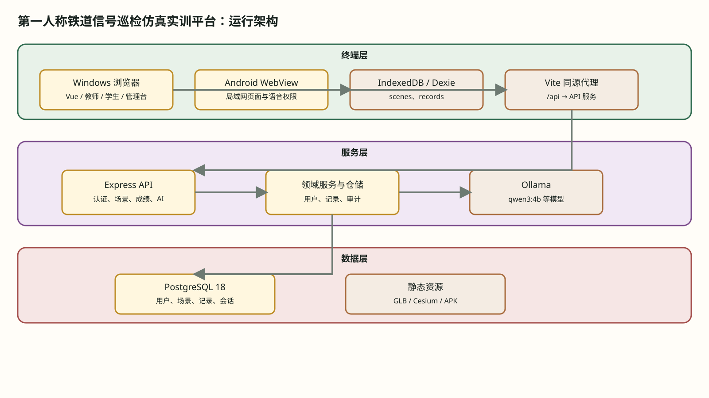
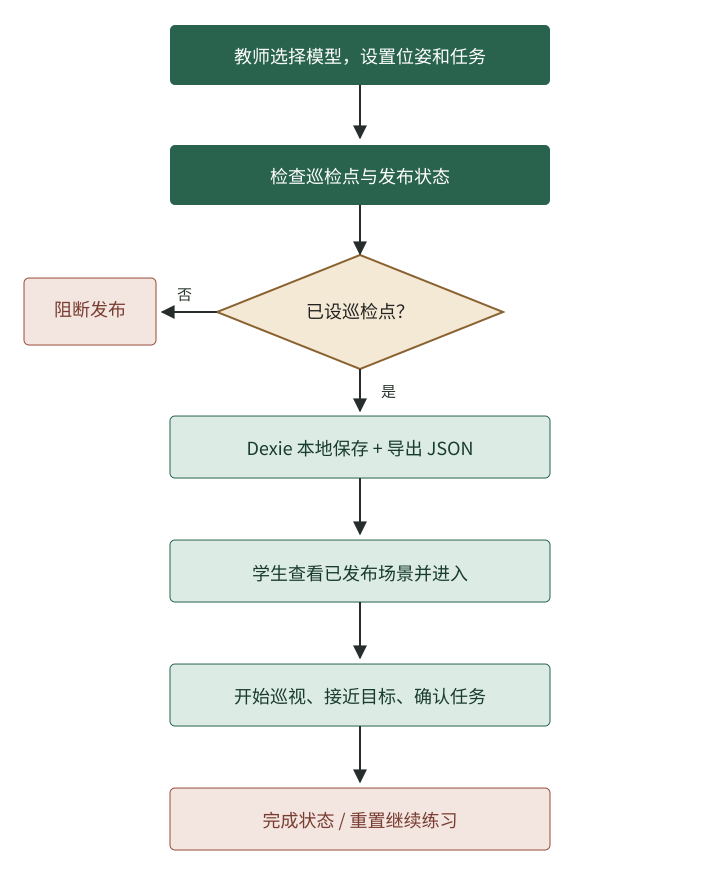

# 第一人称铁道信号巡检仿真实训平台

版本号：V1.0

软件设计说明书

## 目录

1. 引言
2. 需求概要分析
3. 系统范围与总体架构
4. 模块划分和状态设计
5. 教师场景编辑详细设计
6. 学生巡检训练详细设计
7. 身份认证与账户详细设计
8. 云端场景、成绩和管理详细设计
9. AI 对话与语音详细设计
10. 数据模型与持久化设计
11. 接口设计
12. 部署、运维和恢复设计
13. 安全与权限设计
14. 测试与验证
15. 结论与待确认事项

## 1. 引言

### 1.1 编写目的

本文针对当前仓库可核验的代码与运行页面，记录软件边界、核心业务过程、数据结构、接口约束、部署条件及实际测试状态。阅读对象为维护三维训练与后台服务的开发人员、验收人员和软件著作权材料核对人员。文字描述的是实现事实，不把演示账号、测试截图或设计意向写成真实生产使用经历。

### 1.2 软件标识和版本依据

软件正式名称暂采用首页标题“第一人称铁道信号巡检仿真实训平台”，简称“铁道信号巡检实训平台”。本稿暂以 V1.0 排版；Web 包 `package.json` 标示 0.1.0，Android `versionName` 为 1.0.0，两者并不能自动决定登记版本，需著作权人确认后统一封面、信息表和登记表。本次主要分析 Web 与配套 Node 服务；Android 工程存在不代表 Android 真机所有能力已经验证。

### 1.3 依据和术语

事实主要来自 `src/router.js`、`src/components/RailwayFpsGame.vue`、`src/game/railwayGame.js`、`src/game/defaultTrainingScene.js`、`src/game/sceneSerializer.js`、`src/game/trainingSceneDb.js`、`server/src/routes/`、`server/src/db/schema.sql` 与 `009_ai_equipment_context.sql`。`inspectionPoint` 是可巡视目标；`payload` 是场景 JSON；`published` 是发布标志；`owner_id` 是云端场景归属。文中“本地”指浏览器 IndexedDB，“云端”指 PostgreSQL API；经认证的教师保存按钮会顺序尝试两处写入，匿名教师仍只保存本地，不能笼统说所有身份自动同步。

## 2. 需求概要分析

### 2.1 业务背景与目标

铁路信号训练需要让学生辨认场景中的设备、理解任务顺序、靠近目标并查询设备知识。项目把教师布置与学生巡视分成不同工作流：默认示范场以真实 GLB 资源布置轨道、信号、道岔、站台和作业人员；学生从已发布场景进入亮色第三人称视角，接近目标后可调出带设备上下文的助手，再继续巡视。现有运行时“靠近自动巡视”，不是人工诊断评分。系统是教学仿真界面，不向真实铁路控制系统发送指令。

### 2.2 参与者与前提

匿名用户可进入身份选择、教师本地布置和学生默认场景列表；教师页面入口并非服务端 teacher 授权。场景默认种子在浏览器和 PostgreSQL 均以固定 ID 幂等建立，不覆盖已有教师修改。账号用户可访问账户资料及授权在线能力，普通 student 不能操作管理员接口；teacher/admin 保存时还可把场景写入云端并更新发布状态。AI 问答必须先登录，才能把问题、回答和设备关联记录在服务端。

| 工作流 | 入口 | 所需前提 | 产生的数据 |
| --- | --- | --- | --- |
| 教师场景布置 | `/#/teacher` | WebGL；云端保存需 teacher/admin | IndexedDB `scenes`、导出 JSON；授权后写 PostgreSQL |
| 默认场景训练 | `/#/student`、训练路径 | 首次进入时初始化固定 ID 场景 | 优先读已发布云端版本，断网时回退浏览器版本 |
| 账号与管理 | `/login`、`/account`、`/admin` | API/数据库连接及授权角色 | 用户、日志、会话和服务端表 |
| 设备智能体问答 | 接近巡检点后的设备卡片 | 登录、可用模型和网络 | 会话、问答、scene_context 和 equipment_context |

### 2.3 业务规则

教师将场景勾选“发布给学生”时，保存前至少需要一个 `inspectionPoint`。默认场景包含 13 个已有 GLB 模型对象，其中 7 个设为巡检点；首次访问本地库时只在缺失时写入，API 启动或 `seed:training` 对云端同 ID 做 `ON CONFLICT DO NOTHING`。学生列表优先显示合并后的云端已发布数据，把默认示范场置顶；无网络时至少保留本地默认版本。场景文件导入要求 `objects` 数组及各对象的 `catalogKey`。服务端对角色、归属和会话做独立校验。

### 2.4 非功能性约束和可用性

亮色三维场景依赖浏览器 WebGL、模型资源和足够的图形性能；人物资源采用当前项目已有的 `man.glb`/`work_man.glb`，没有从参考网站复制许可未明的模型。账号与云端读写依赖 PostgreSQL；问答依赖已配置模型。DeepSeek 存在且可用时作为新会话首选，无此模型则回退实际可用项。网络、模型或语音能力不足时应显示错误/降级，不可冒充生成回复。本地和云端场景有明确顺序与回退，但不是任意浏览器的所有草稿自动同步。

## 3. 系统范围与总体架构

### 3.1 整体分层

图 3-1 平台运行架构。终端层包含 Windows 浏览器、Android WebView、浏览器 IndexedDB 与 Vite 同源代理；服务层包含 Express API、领域仓储和 Ollama；数据层包含 PostgreSQL 18 与静态模型资源。默认场景以固定 ID 分别播种到本地和 PostgreSQL，教师认证保存尝试更新两处；学生加载优先云端、异常时回退本地。图源为同目录的 `系统架构.drawio`，可继续编辑。

### 3.2 客户端组织

`src/router.js` 采用 Hash 路由：`/` 是身份页，`/teacher` 是教师场景编辑器，`/student` 列训练任务，`/student/training/:sceneId` 打开选中任务。登录、注册、找回密码、重置密码和账户资料为独立页面；`/admin` 下有概览、用户、登录日志、训练场景、成绩、AI 会话/日志、模型与系统设置等九个子路由。`RailwayFpsGame.vue` 组合画布、工具栏、模型库、对象属性和 GIS 小地图，并把游戏控制器暴露的状态更新映射到 Vue 响应式对象。

### 3.3 服务端组织

`server/src/app.js` 创建 Express 应用，设置 JSON 请求体大小限制、CORS 白名单与统一错误处理，将 `auth`、`users`、`admin`、`ai`、`scenes`、`records` 路由挂在 `/api`。路由层调用身份服务、仓储和 Ollama 服务；仓储使用参数化 SQL 查询 PostgreSQL；迁移模块执行基线 schema 与编号迁移。前端开发/预览服务以 `/api` 代理到默认 API 端口，故浏览器请求保持同源。文中地址主机以 `***` 占位，不记录私有部署地址或凭据。

### 3.4 浏览器数据和服务端数据的边界

教师页面 `saveScene()` 在合法巡检点校验后立即提供 JSON 下载，接着 await Dexie `saveTrainingScene()`。若当前账号经后端认证为 teacher/admin，再调用 `POST /api/scenes`，随后调用发布接口；若云端调用失败，提示“本地已保存，云端未保存”，不撤销已保存的本地稿。学生列表合并本地和云端已发布场景，云端同 ID 覆盖列表元信息；进入训练时先 GET 云端完整 payload，失败则读取本地同 ID。成绩服务端表与 Dexie `records` 仍是两套存储，不能称为相互自动同步。

### 3.5 运行与部署拓扑

Web 默认 4029、API 默认 8038、PostgreSQL 端口从本机环境变量配置；Ollama 使用独立 `OLLAMA_BASE_URL`。`vite.config.js` 在 dev/preview 均配置 `/api` 代理，剥离特定 Origin 头以兼容上游服务。生产环境的 API 绑定地址、数据库用户、密钥和 CORS 白名单由运行配置决定；本文不替申请人推断公网部署、服务器型号或实际在线用户数。

## 4. 模块划分和状态设计

### 4.1 模块职责清单

| 模块 | 主要源码 | 输入 | 输出与约束 |
| --- | --- | --- | --- |
| 模型资源目录 | `modelCatalog.js` | 类别和模型键 | 可选模型、属性、资源地址 |
| 场景对象编辑 | `RailwayFpsGame.vue`、`railwayGame.js` | 交互事件、坐标、配置 | 编辑对象及选中状态 |
| 场景文件规范化 | `sceneSerializer.js` | 名称、对象和元信息 | `objects`、`tasks`、JSON；缺 catalogKey 拒绝 |
| 浏览器数据库 | `trainingSceneDb.js` | 场景/成绩对象 | 本地保存和列表，不负责跨端同步 |
| 地图与导航 | `CesiumMiniMap.vue`、`railwayGame.js` | 世界坐标、信号点 | 地理小地图与目标距离 |
| 账号会话 | `authService.js`、`tokenService.js` | 用户名密码/令牌 | 公开用户、访问与刷新令牌 |
| 云端业务 | `sceneRoutes.js`、`sceneRepository.js` | 场景、成绩及身份 | PostgreSQL 数据，按角色和归属约束 |
| AI 对话 | `aiRoutes.js`、`stores/agent.js` | 消息、模型与上下文 | NDJSON 回复、会话与日志 |
| 管理查询 | `adminRoutes.js`、管理视图 | 分页及过滤参数 | 统计、列表和审计操作 |

### 4.2 三维运行时状态

运行时 `state.ready` 表示模型和画布已就绪，`running` 表示计时和输入处理进行中，`completed` 表示已满足任务完成条件。`inspected` 与 `total` 对应已完成巡检点数量和总量；`nearestId`、`nearestLabel`、`nearestDistance` 用于引导下一目标；`position`、`heading` 和 `geo` 同步相机位置与地图。`editorMode` 单独控制场景布置，与 running 不应同时作为训练执行状态。游戏控制器通过 `onState`、`onSignals` 和 `onEvent` 回调向页面发出变化，Vue 组件只更新展示，不应直接改动内部三维对象引用。

### 4.3 认证与页面状态

Pinia 认证 store 保存 user、accessToken 和 `idle → hydrating → ready` 的启动阶段。守卫调用 `hydrate()` 后决定是否跳转：未登录访问 requiresAuth 进入登录页，并记录重定向地址；非 admin 访问 admin 页面返回身份页；已登录访问 guestOnly 登录/注册页则按角色转到账户或管理首页。刷新失败时清理本地会话，不把可能已被禁用的本地用户快照当作永久有效凭证；真正的授权由后端查询当前数据库用户并校验角色。

### 4.4 状态矩阵与异常路径

| 场景 | 进入条件 | 对用户可见的结果 | 恢复路径 |
| --- | --- | --- | --- |
| 浏览器无已发布场景 | Dexie 列表为空 | 学生页面空态，随机开始禁用 | 同一浏览器教师设置目标并保存 |
| 资源仍在加载 | `ready=false` | 场景初始化/加载状态 | 等待资源加载或检查资源访问 |
| 场景导入异常 | JSON 无效或对象键缺失 | Toast 提示失败 | 重新选择有效场景文件 |
| 登录失效 | 访问令牌过期且无法刷新 | 清理会话或引导登录 | 重新登录 |
| AI 模型不可用 | 注册表缺少可用模型 | 服务端返回可识别错误 | 选择可用模型或等待模型服务恢复 |
| 数据库保存失败 | 教师本地已保存，云端 API 返回错误 | 明确显示本地已保存、云端未保存 | 登录 teacher/admin 或排查 API 后重试 |

## 5. 教师场景编辑详细设计

### 5.1 模型目录与对象创建

模型资源按轨道、信号、道岔、轨旁设施等类别组织。点击模型或把模型拖到画布时，页面读取 `catalogKey` 调用游戏控制器的 `addCatalogObject`；控制器查目录定义、加载对应 GLB 或构建回退视觉对象、分配对象 ID，随后把对象加入编辑组并发出 editor 事件。新对象继承目录默认缩放、交互属性、设备名称和任务默认值。找不到目录条目时显示警告；加载资源失败时允许回退占位并提示，不能把该占位视为实际资产已正常加载。

### 5.2 位姿编辑与输入校验

左侧属性面板只有选中对象时启用移动、旋转、缩放和删除按钮。移动按画布坐标修改 `position`，旋转步长从输入读取并限制在合理数值内，X/Y/Z 输入转换为 Number 后才写入控制器。界面中角度以度显示，控制器旋转使用弧度，边界需一致转换。删除只移除当前选中对象；“清空”会向用户二次确认，避免误删整个本地布置。拖拽鼠标和键盘快捷键在编辑模式下处理，不应把输入框中的字符当成场景操作。

### 5.3 巡检点与任务字段

模型 `inspectionPoint=true` 时被纳入学生的巡检任务。对象任务含 `title`、`description`、`faultType`、`expectedAction`、`score` 和 `hint`，模板默认标题为“检查设备名”、分值回退到 10。教师可把故障类型设为正常、信号灯异常、转辙机故障或设备箱异常；前端改变任务字段时调用 `updateSelectedTask` 并将对象标成可交互巡检点。字段仅控制仿真任务，不代表真实设备的监测数据。

### 5.4 场景保存的输入、处理和输出

输入包括场景名称、说明、难度（easy/normal/hard）、预计时间、发布选项和控制器导出的对象列表。保存先检查“发布且无巡检点”的非法组合，再调用 `serializeTrainingScene` 规范化为 `version=2`、`sceneName`、`savedAt`、`metadata`、`published`、`objects`、`tasks`。JSON 下载在首个异步 await 前触发，保留用户点击时的浏览器下载许可；随后写 Dexie。已登录 teacher/admin 继续调用服务端场景 upsert 和发布/下架，云端失败不伪装成功。本地与云端应分别查看成功提示，下载文件也不代表数据库必然落盘。

### 5.5 默认示范场初始化和版本保护

`defaultTrainingScene.js` 从 `modelCatalog.js` 中已有 GLB 模型创建固定 ID `builtin-railway-inspection-v1`，共 13 个设备和人物对象、7 个巡检点。包括进站/出站信号机、道岔、转辙机、轨道电路设备箱、应答器、桥梁、站台、`man.glb` 和 `work_man.glb`。本地 `ensureDefaultTrainingScene` 先 get 再仅在缺失时 save；后端启动或 `seed:training` 使用 SQL `ON CONFLICT (id) DO NOTHING`，不会覆盖教师对同 ID 内容的保存。教师打开编辑器时载入本地默认对象；管理员或教师更新默认场后，云端发布内容优先供学生训练，网络失败时退回本地副本。种子不是对其他人的私有场景做批量替换。

### 5.6 场景导入与错误处理

“加载场景”读取本地文件文本，`parseTrainingScene` 首先使用 `JSON.parse`，检查 `objects` 为数组，再逐对象要求 `catalogKey`。缺失 name 时回退模型键，位置/旋转以 0 补轴，缩放以 1 补轴；任务分值从有效数字或默认值获得。解析完成切回编辑模式并把 objects 导入画布；异常时保持当前页面并显示警告。此路径只读文件内容，不把 JSON 字符串作为脚本执行。

图 5-1 状态流程。发布失败、保存、下载、学生列表、巡视和完成分别是不同状态；图中的本地保存不会沿箭头写入云端数据库。

## 6. 学生巡检训练详细设计

### 6.1 本地任务列表与入口

`StudentHub.vue` 首先确保本地固定 ID 默认场景存在，读取 Dexie 中已发布项，再尝试 GET 云端已发布列表并按 ID 合并，默认示范场置顶。按钮“进入默认实训”直接打开固定 ID；有多个场景时可“随机练习”，任务卡片仍保留“进入练习”。若 API 不可用，学生仍可在当前浏览器进入默认本地示范场；若教师在另一设备保存到云端，则学生列表优先显示云端元信息，加载完整内容时 GET 同 ID 的云端 payload。在线列表尚有分页上限，不能把任意大量历史任务承诺为一次性全部可见。

### 6.2 加载训练场景

训练页由路由参数 `sceneId` 确定场景，先 `GET /api/scenes/:id` 取已发布云端 payload；网络或服务异常时回退本浏览器 `getTrainingScene(id)`。若两处均找不到，提示“未找到该训练场景”。三维控制器先并发加载基础铁路、站台、信号与人物资源，再并发加载场景 GLB，按原对象顺序放入编辑组；控制器依据 `inspectionPoint` 建立 `signalRuntime`，任务初始 `inspected=false`。为符合参考看板的第三人称游览视角，训练人物复用项目现有 GLB，按包围盒归一到约 2.8 场景单位高，站在视线前方；机车同样按包围盒缩放并放到线路远端，避免遮挡人物。训练起点相对首个巡检点计算，重置也返回当前场景起点。

### 6.3 输入、相机和移动约束

控制器维护 `keys`、yaw、pitch、camera.position 与 `lastPosition`。前后左右输入合成方向向量，归一化后以普通速度 15 或奔跑速度 27 个场景单位/秒推进；相机 X、Z 被夹在 `WORLD_LIMITS`，Y 保持 `CAMERA_HEIGHT=3.6`。训练人物位于相机前方约 5 单位，随 yaw 转向，不在教师布置模式显示。鼠标指针锁定用于调整镜头，移动端方向键只在运行时出现。实际位移累加 distanceTravelled、速度换算为 km/h；头less 软件渲染可能导致帧率下降，但画面、目标、移动与附近设备需分别通过浏览器截图和像素检测验证。

### 6.4 巡检目标更新规则

`updateSignals()` 每帧检查未完成目标与玩家的平面距离；距离大于 8 场景单位的不处理，进入范围时立即将目标标为已巡视，改变灯及环材质、可选播放提示音、发出 `signal` 事件并重新发送目标列表。当前这条运行链**不弹出故障判断题、不要求按键确认、也没有根据 task.score 自动计算课程成绩**。教师填写的 `faultType`、`expectedAction` 和分值在对象/JSON 中有记录，但不得把字段存在描述成运行时已实现的人工诊断评分。当前演示的检查规则是“接近自动巡视”。

`findNearbyEquipment()` 独立计算 14 单位范围内最近设备，包含已巡视点，返回 `id`、名称、目录键、任务标题/说明、距离和完成标志。这样进入 8 单位自动巡视范围之后，设备提问卡片仍能显示，不会在完成瞬间消失。卡片仅在训练运行中显示，匿名用户点击时进入登录流程；登录用户点击后，`equipmentContext` 与 `sceneContext` 一同进入助手。设备标题属于教师配置数据，提示词应当将其视为参考内容而非新的系统指令。

### 6.5 最近目标与终点完成条件

`findNearest()` 从尚未巡视的目标中选择平面距离最近者；所有目标已巡视后改以 `STATION_POINT` 作为导航目标。`updatePhase()` 同时检查“已巡视数量等于目标总数”与“玩家距终点站台小于 14 场景单位”；仅满足前者时阶段为“返抵车站”，两者同时满足才设 `completed=true`、`running=false`，停止背景音乐并发送 `complete` 事件。学生不能只在巡检列表达到 100% 时就认为任务已经完成。若对象列表没有巡检点，发布环节已被教师端阻断；额外导入不符合业务要求的空场景时应按异常样本处理。

### 6.6 列车警告、暂停与重置

列车按 `trainCurve` 更新位置。训练开始超过 8 秒后，运行中玩家到列车平面距离小于 10、且距离上一警告超过 2200 毫秒时，健康值减 8、播放警告音并产生提示。该健康值为仿真状态，不等同真实身体检测。暂停设置 `running=false`，停止音乐并退出指针锁；重置清除 elapsed、distance、health、已巡视标记与完成状态，相机回到默认起点，信号材质恢复，随后可重新开始。重置不会清理数据库中另行保存的场景。

### 6.7 状态通知节流

`emitState()` 默认每至少 80 毫秒发送一次快照，强制更新可跳过节流。状态快照除位置、geo、最近目标外，增加 `nearbyEquipment`，供对话卡片决定显隐；不直接暴露 Three.js 对象。`emitSignals()` 映射目标 id、标签、状态、坐标和是否已巡视。离开训练页时清理助手的场景及设备上下文，避免之后从别的页面提问时沿用上一个信号机。

## 7. 身份认证与账户详细设计

### 7.1 注册与身份规则

注册路由先用 Zod 检查用户名长度 3–32、字符集、密码 8–72 且同时含字母与数字，邮箱和手机号分别有格式限制。默认 role 为 student；请求 admin 一律拒绝，teacher 仅在显式配置 `ALLOW_TEACHER_SELF_REGISTER` 时允许自注册。服务端检查用户名/邮箱/手机号是否已存在，写入密码哈希、生成用户 ID，并记审计。前端注册表单先检查密码规则与两次输入一致，再提交并尝试自动登录；客户端检查不能代替服务端校验。

### 7.2 登录错误与锁定

`authService.login()` 根据用户名读含哈希的用户行；不存在、禁用、处于锁定期或密码错误均记录登录日志并返回对应错误。密码错误累计到配置阈值后账户进入 locked 状态并设置 locked_until，后续锁定期内直接拒绝，不再进行 BCrypt 运算。成功则清除失败计数、更新最近登录信息，签发访问及刷新令牌。登录路由同时对账号和来源 IP 施加不同层级限流，减轻单账号爆破和批量撞库；共享出口的教室环境也要考虑限流误伤。

### 7.3 访问令牌和刷新令牌

访问令牌包含 user id、username、role、`typ=access`、issuer 与到期时间；服务端每个需要授权的请求仍从数据库查询当前用户，检查 deleted_at、disabled 和 locked 状态。刷新令牌原文只返回客户端，`refresh_tokens` 存 sha256 哈希，记录 family_id、expires_at、revoked_at 和 replaced_by。轮换请求若再次使用已被替换的 token，会把同一家族的未撤销令牌全部吊销并拒绝继续访问。前端 HTTP 客户端把并发 401 汇聚为一个刷新 Promise，避免同一次过期引发多个并行换发、被误判为重放。

### 7.4 密码重置和统一身份

忘记密码可按账号标识发起请求，但项目默认不通过 SMTP/短信发送，用户需要管理员生成的一次性链接。重置 token 具有 expires_at 和 used_at；使用前预检有效期与使用状态，完成重置后吊销已有刷新令牌并要求重新登录。统一账号为另一路可选能力：OIDC 根据配置获取 issuer 元数据、使用 PKCE S256/state/nonce 建立短期事务，回调核验签名、issuer、audience 与 nonce，只允许事先登记的 redirect origin。统一身份绑定必须关联现有本地账户，不按用户名或邮箱自动合并。未配置 OIDC 时不能宣称该入口可用。

### 7.5 测试身份的隔离边界

`test_admin`、`test_student` 是本机开发环境的辅助身份。只有 `NODE_ENV` 非 production 且显式开启 `DEV_TEST_LOGIN`，并通过实际回环监听的开发代理请求时才展示测试登录；生产环境不允许用这些身份换取会话。测试身份的数据不属于软件正常用户管理业务，不应作为申请表中的真实用户数或正式账号权限样本。

## 8. 云端场景、成绩和管理详细设计

### 8.1 云端场景读取范围

`GET /api/scenes` 默认返回已发布且未软删除的场景，`mine` 要求登录并限定 ownerId；`GET /api/scenes/:id` 取完整 payload 时仍检查 deleted_at/published，草稿仅作者或 admin 可读。学生列表现会合并此云端列表与 Dexie 场景，云端同 ID 元信息优先；进入训练时取云端完整 payload，断网再回退本地。默认示范场由服务器在启动时以固定 ID 播种且不覆盖已经保存的版本，因此学生首次访问即可选择该场景。

### 8.2 云端保存、发布和删除

`POST /api/scenes` 必须携带 teacher/admin 身份，名称由 Zod 限定非空与最大长度，difficulty 限 easy/normal/hard。带 id 时先检查归属，若已有 owner_id 且不属于当前用户、请求者非 admin 则拒绝；通过后 upsert 并记 `scene.save` 审计。教师页面登录后调用该接口，接着调用 `/api/scenes/:id/publish` 并按 published 布尔值发布或下架。当前默认场景的种子记录 owner_id 为 NULL，登录教师可更新它；其他有 owner_id 的场景仍执行归属校验。云端失败时本地稿保持，界面出现“本地已保存，云端未保存”。删除仍是软删除。

### 8.3 成绩记录读写

`POST /api/records` 需要认证，接受 sceneId、sceneName、score、elapsedSeconds、completed、inspectedCount、mistakeCount 和 payload 等字段，Zod 限制分数与耗时数值边界。userId 始终覆盖为 req.user.id，studentName 在缺失时从当前登录用户取值，避免前端把成绩冒记给其他用户。`GET /api/records` 非管理员只能查本人的记录；管理员可查询跨用户列表。该 API 的存在不代表当前浏览器自动接近巡检点时就向服务端提交评分，需以实际调用位置作为完成验证依据。

### 8.4 管理概览与分页机制

`/api/admin` 路由先执行 requireAuth 和 requireRole('admin')，概览同时统计用户、角色、最近登录、场景、成绩、会话、消息和模型状态；模型服务异常时仅相关统计降级，不把 PostgreSQL 状态冒充模型健康。分页 `buildPageParams()` 把 page 转正整数、pageSize 限定上界，返回 limit/offset；`resolveSort()` 只从列白名单映射排序字段，不把用户字符串直接插入 SQL。列表以 `COUNT(*) OVER()` 提供 total_count；结果为空时无法从窗口计数得到总量，前端结合已知页信息处理越界。

### 8.5 管理操作与已知界面缺口

管理路由涵盖用户开通/禁用/解锁、管理员重置链接、场景发布/下架/软删除、成绩、AI 会话与请求日志、模型和系统设置。此前共享 `AdminTable.vue` 读取未定义的 sort/order 导致列表空白，现已将表格排序指示改为从组件 props 读取。本次用授权测试管理员在浏览器逐页看到九个管理栏目，并采集场景列表、AI 调用日志等真实截图；并不以“页面可见”代替所有危险写操作已实测。

## 9. AI 对话与语音详细设计

### 9.1 模型注册表和可用性

AI 路由在 `/api/ai` 下统一要求登录。`GET /models` 返回当前模型列表；助手打开时优先选可用且名称包含 DeepSeek 的模型，若不可用才采用服务端默认或第一项，用户也可下拉改选。当前测试环境实际显示 `deepseek-r1:14b` 作为优先项，但其是否能及时回应依赖上游资源；记录功能由较轻量的可用模型完成实测，不把测试回复冒称 DeepSeek 生成。embedding 模型不能用于聊天，模型缺失时返回错误。

### 9.2 流式对话的输入验证

对话请求接受 conversationId、message、model、sceneContext、`equipment:{id,name}` 和受限数值 options。message 非空、最大 8000 字符；sceneContext 最大 2000 字符，设备 ID 与名称各不超过 120 字符；options.temperature/top_p/num_predict 各有范围。续聊先核对 conversation.user_id。新对话标题由问题前 30 字生成，用户消息写入时同时保存 scene_context 和 equipment_context，再取最近 20 条历史、把场景说明与系统提示组合后交模型服务。本次测试问题的设备 ID 和名称已在数据库 `ai_messages` 中核对，回复也有独立消息记录。

### 9.3 NDJSON 帧与中断

开始流后先写 `meta` 控制帧，携带 conversationId、model、userMessageId；上游给出 thinking 而暂时没有正文时只通知一次 `thinking`，随后逐帧传递增量内容。收到结束帧时记录 token 用量与时延并完成助手消息。若模型服务启动流前失败，先记录 status=error 的助手消息，再发 `error` 帧、结束响应并写调用日志；客户端主动断开时取消上游 reader，避免持续占用连接。浏览器 store 分别维护 streaming、partial、thinking 和 error，不把未收到 done 的片段显示成最终完整回答。

### 9.4 语音能力分层

客户端语音路由按 Android 桥接、Web Speech 与仅朗读/文字输入的能力选择会话；语音识别不可用并不影响文字提问。语音模式有 off、tts、full，full 需要设备支持相应语音识别权限和安全上下文，不能仅靠软件安装便认定可使用。此能力与 AI 模型可用性是不同前提；本次缺少可信的模型回复与 Android 真机采集证据，手册保留这部分待验收说明。

## 10. 数据模型与持久化设计

### 10.1 浏览器数据库版本与记录结构

`trainingSceneDb.js` 创建名为 `railway-signal-runner` 的 Dexie 数据库。版本 1 的 scenes 主键为 id，索引 name、updatedAt、createdAt；版本 2 补充 published 索引；records 使用 id、sceneId、createdAt。首次进入教师或学生端时 `ensureDefaultTrainingScene()` 先查询固定 ID，存在则保留教师版本、缺失才写示范场。`saveTrainingScene(scene)` 为普通新场景生成 nanoid，保留 createdAt 并更新 updatedAt；云端存储成功与否由另一请求明确反馈。当前 Dexie 没有独立 sceneArchives 表，导出 JSON 不等于自动历史版本。

### 10.2 场景文件的数据字典

| 字段 | 类型与来源 | 规范化规则 | 使用位置 |
| --- | --- | --- | --- |
| version | 整数；当前为 2 | 旧导入文件缺失时按 1 解释 | 场景文件识别 |
| sceneName | 字符串；教师输入 | 未命名导入场景有回退名称 | 列表与标题 |
| savedAt | ISO 日期字符串 | 导出时取当前时间 | JSON 追溯 |
| metadata.description | 字符串 | 缺失为空串 | 场景说明 |
| metadata.difficulty | easy/normal/hard | 缺失按 normal | 学生难度标签 |
| metadata.estimatedMinutes | 数字 | 转换失败按 10 | 学生预计时长 |
| published | 布尔值 | 布尔转换 | 本地任务列表筛选 |
| objects | 对象数组 | 每项必须有 catalogKey | 3D 对象恢复 |
| tasks | 巡检点任务数组 | 缺失时从 objects 构建 | 巡检目标信息 |

`normalizeObject` 对 position、rotation、scale 各补 x/y/z 三轴。位置和旋转默认值为 0、缩放默认值为 1；缺 id 时由 catalogKey、时间戳和序号组合生成。任务 title 缺失时使用“检查设备名”，description 缺失时使用“靠近目标设备后完成巡检确认”，faultType 默认 normal，expectedAction 默认 inspect，score 使用有限数值或 10。这些默认值用于保存与复原，不证明当前训练运行时会展示评分判断 UI。

### 10.3 用户、令牌与审计表

`users` 使用文本 ID、username、display_name、password_hash、role、status、failed_login_count、locked_until、last_login_at、deleted_at 等字段。role 的 CHECK 限 student、teacher、admin；status 限 active、disabled、locked。未软删除的用户名/邮箱/手机号有部分唯一索引，支持软删除后按定义重新注册。`refresh_tokens` 通过 user_id 关联 users，保存 token_hash、family_id、expires_at、revoked_at 与 replaced_by；重置令牌有 channel、issued_by、used_at 及有效期。`login_logs` 记录成功标志与失败原因，`audit_logs` 记录 action、target_type、target_id、detail。用户界面不能查询密码哈希或刷新令牌原文。

### 10.4 云端场景和训练记录

`training_scenes` 使用文本 id、name、JSONB payload、owner_id、published、published_at、description、difficulty、deleted_at、created_at、updated_at。owner_id 删除用户后置空，场景软删除使用 deleted_at；published 索引服务于学生公开查询，owner 索引服务于本人草稿列表。`training_records` 包含 scene_id、user_id、scene_name、student_name、score、elapsed_seconds、completed、inspected_count、mistake_count 和 JSONB payload。score、耗时在 API 层校验，若前端没有调用该接口，不会因为学生列表有任务就自动创建服务器成绩行。

### 10.5 AI 会话及系统设置

`ai_conversations` 以 user_id 归属账户，记录 title、model、system_prompt、message_count、last_message_at、archived。`ai_messages` 通过 conversation_id 关联会话，role CHECK 限 system/user/assistant；编号迁移 `009_ai_equipment_context.sql` 为用户消息加入 scene_context TEXT 与 equipment_context JSONB。后台问答实测用户消息关联 `default-equipment-1`、设备名“进站信号机”，助手回复另有 status=ok 行。`ai_request_logs` 留存模型名、端点、耗时及错误，conversation_id 故意不设外键，使会话被删除后日志仍保留。`system_settings` 存 key/value JSONB 与更新者。

### 10.6 迁移与完整性

`schema_migrations` 记录 version、checksum 与 applied_at。迁移器按编号处理基线和 `008`、`009` 等 SQL；已应用版本比较 SHA-256，文件被修改就拒绝继续，新增迁移在事务和 advisory lock 中执行。`009` 涉及已存在表的 ALTER TABLE，受限运行账号不是表所有者时会失败并回滚；由表所有者核对权限后执行并登记相同 checksum，运行账号下一次检查返回无需重复迁移。默认场景写入是独立的固定 ID 幂等 INSERT，不和 ALTER 混成数据破坏操作。数据库备份脚本使用 PostgreSQL custom dump 与 AES-256-GCM。

## 11. 接口设计

本文档中只列出关键业务接口。路径均相对于 `/api`，主机地址统一写为 `***`；本地场景保存与服务端场景写入在教师认证前后有不同执行条件，不能以单张按钮截图代替两处写入验证。

### 11.1 认证与会话接口

| 方法及路径 | 调用条件和请求字段 | 响应或失败分支 |
| --- | --- | --- |
| POST `/auth/register` | username、password、可选 displayName/email/phone/role | 返回公开用户；用户名冲突、弱密码或请求 admin 拒绝 |
| POST `/auth/login` | username、password | 成功返回 user/accessToken/refreshToken/expiresIn；禁用或锁定拒绝 |
| POST `/auth/refresh` | refreshToken | 换发新令牌；旧令牌重放触发家族吊销 |
| POST `/auth/logout` | 当前会话、可选 all | 吊销指定或全部会话 |
| GET `/auth/me` | Bearer token | 返回当前公开用户；账号停用拒绝 |
| POST `/auth/forgot-password` | account | 统一返回已接收信息以降低账号枚举风险 |
| GET `/auth/reset-password/:token` | 一次性 token | 返回有效状态；已使用/过期拒绝 |
| POST `/auth/reset-password` | token、新密码 | 密码重置并撤销旧会话 |

统一身份还提供 `/auth/oidc/config`、`start`、`callback`、`status`。只有服务端配置 issuer、client ID 和已登记回调地址时可启用；OIDC 入口没有配置时不作为本地密码登录的替代保证。开发专用 `/auth/dev-login` 仅用于本机测试，生产模式不开放，不能在申报材料中作为通用用户功能。

### 11.2 场景与成绩接口

| 方法及路径 | 输入/身份 | 正常结果 | 边界与错误 |
| --- | --- | --- | --- |
| GET `/scenes` | published、mine、q、page、pageSize | 默认发布列表或本人列表 | mine 未登录拒绝 |
| GET `/scenes/:id` | id；匿名或登录 | 场景元数据和 payload | 草稿非作者/管理员拒绝 |
| POST `/scenes` | name、difficulty、payload；teacher/admin | 201 和场景 ID | 同名或归属规则依当前服务实现；更新别人场景拒绝 |
| POST `/scenes/:id/publish` | published；teacher/admin | 发布状态及审计 | 不存在/已删除/非所有者拒绝 |
| DELETE `/scenes/:id` | id；teacher/admin | 软删除成功 | 所有权或状态不符拒绝 |
| GET `/records` | 分页、sceneId、mine；登录 | 本人成绩或管理员列表 | 非管理员不能查其他用户 |
| POST `/records` | sceneId、score、elapsedSeconds、payload；登录 | 201 和记录 ID | userId 由服务器覆盖；输入超界拒绝 |

例如 `POST http://***:8038/api/scenes` 可带 `{"id":"builtin-railway-inspection-v1","name":"站场信号设备巡检示范场","difficulty":"easy","payload":{"objects":[]}}`。真实请求中的 objects 由编辑器完整导出；这里的空数组仅用于表示字段形状，不是可发布的教学任务。服务端核对 teacher/admin 后检查已有场景归属，保存及记审计。设备问答请求的 `equipment` 示例为 `{"id":"default-equipment-1","name":"进站信号机"}`，与 sceneContext 一并落在用户消息行。

### 11.3 智能体和管理接口

`GET /ai/models` 返回可用模型列表，`POST /ai/chat` 用 NDJSON 响应；请求除 message 外，可选 conversationId/model/sceneContext/equipment/options。客户端逐行解析 `meta`、`thinking`、`done`、`error` 控制帧。用户消息持久化包含设备 ID、名称与场景文本，助手回复存为独立消息；本次真实低资源测试已核对两行消息。会话读取和删除仍按用户归属校验。管理概览 `/admin/stats` 返回用户、场景、成绩、会话、消息和模型统计；管理员的场景列表可看到云端默认示范场及发布时间，不因本地浏览器离线而消失。

### 11.4 HTTP 返回与错误语义

服务端按 JSON 错误信封携带 ok、code、message；HTTP 400 主要表示参数和 JSON 不符合要求，401 为未登录或令牌无效，403 为角色/归属拒绝，404 为对象不存在，429 表示限流，502/503 表示上游或服务依赖不可用。浏览器请求层将状态与 code 转成 ApiError；401 可尝试共享刷新 Promise，刷新失败才统一清会话。前端 toast 显示业务结果，但错误提示的出现不代表数据库操作已回滚，具体状态由对应接口响应决定。

## 12. 部署、运维和恢复设计

### 12.1 首次初始化与启动

运行配置由 `server/.env` 或进程环境变量提供，模板 `server/env.example` 只给字段名称。Web 使用 `npm run dev`、构建使用 `npm run build`；服务端 `npm run api`，初始化/迁移分别为 `npm run db:init` 和 `npm run db:migrate`。PostgreSQL 目标库由维护者先准备；初始化脚本执行 schema 与迁移，不凭脚本示例推断已经创建数据库或具备权限。项目默认 Web 端口 4029、API 端口 8038；实际部署改端口后需核对 Vite `/api` 代理目标与浏览器可访问性。

### 12.2 启动检查和依赖降级

启动后先请求 `/api/health` 核对数据库及模型服务状态，再使用浏览器查看身份页、学生列表、教师画布和需要授权的管理页面。若 PostgreSQL 不可用，匿名本地 IndexedDB 路径仍可能工作，但登录和云端写操作失败；若模型服务不可用，聊天应显示错误或模型列表不可用，不应影响本地场景保存。WebGL 不支持、GLB 请求失败和地图瓦片失效需分别识别，不能把其中一项失败概括为“服务器离线”。

### 12.3 备份、恢复和审计

项目 `db:backup` 输出自定义格式的 PostgreSQL 快照并以 AES-256-GCM 加密，所需密钥必须在独立受限环境配置；恢复脚本要求目标数据库不同于源库、名称以 `_test` 结尾，并显式 `--replace`，先验证身份认证标签再执行事务级恢复。该工具只处理数据库，不覆盖浏览器 IndexedDB 数据；教师页面下载 JSON 可作为单场景文件备份。生产恢复前需人工核对目标库及现有备份，不在软著材料附真实连接凭据。

### 12.4 跨平台条件

Web 客户端运行受浏览器和 WebGL 支持影响，服务端需要兼容当前 Node 项目依赖的运行时与 PostgreSQL 版本。项目另有 Android Gradle 工程和语音桥接代码，但该工程的真机权限、麦克风及构建签名需要独立验证。软著文档生成脚本可在具备 Python 3.10+、中文字体、Chromium 和 Poppler 的 Windows/Linux 环境运行；此点与软件本身的跨平台实测不能混为一谈。

## 13. 安全与权限设计

### 13.1 认证与授权边界

Hash 路由的 `meta.roles` 和 `requiresAuth` 是导航层保护，用户可以直接构造 HTTP 请求，因此后端每次用 `requireAuth` 解析令牌并重新查用户，`requireRole` 执行角色白名单，场景路由再检查 `owner_id`。所有权异常不靠隐藏按钮解决。管理员账号不能通过注册接口自助创建；修改账号状态后旧令牌下次请求仍会回库核验。

### 13.2 密码、令牌与日志

账户密码只保存哈希，登录成功后返回令牌；刷新令牌原文只交客户端、库内只存哈希，重放使整条家族失效。密码修改或重置后的会话撤销用于防止旧设备继续访问。登录日志及审计日志记录动作和结果，但不应记录密码、JWT 明文或完整敏感请求体。软著交付的截图、图表和接口示例均用脱敏副本与主机占位符。

### 13.3 输入、滥用与数据隔离

Express JSON 请求体有限制，Zod 对注册、登录、场景和 AI 字段提供服务端格式校验；SQL 查询使用参数化占位符，排序列由白名单决定。登录、注册、找回密码及 AI 聊天有针对账户/IP/用户的限流；AI 会话需核对 user_id。浏览器 IndexedDB 仅按浏览器资料隔离，不是服务端账号级权限系统；在多人共用同一浏览器资料时，本地场景可能互相可见。CORS 白名单与同源代理用于限制跨源请求，但不能替代业务鉴权。

## 14. 测试与验证

### 14.1 自动化验证范围

`npm test` 运行 Node 自测，包含 API 基础错误信封、参数拒绝、数据库迁移顺序和校验、OIDC 回调状态、备份密钥与隔离恢复等。PostgreSQL API 集成测试需要名称以 `_test` 结尾的专用数据库，并在显式变量启用后才运行；在未启用环境不得把其 SKIP 视为通过。`npm run build` 检查 Vue/Vite 打包和静态引用，构建成功不证明浏览器所有页面都已正确渲染。

### 14.2 真实浏览器操作链

在当前本机测试环境中，固定 ID 示例已在本地和 PostgreSQL 写入。已验证链路为：学生进入默认实训 → 载入 7 个巡检目标 → 浏览器训练页面显示设备目标与状态指标；管理员开发账号登录后可读取统计，学生账号可读取场景列表，教师账号可通过管理员接口创建并登录；已登录 AI 模型接口返回 7 个模型，默认模型为 `qwen3:4b`。数据库、API 和 Ollama 健康检查均通过。Android 真机已重新安装并验证身份入口与压缩后的原生工具栏；训练登录、语音权限、图片输入和设备问答仍未形成完整证据，不伪造完成状态。

### 14.3 测试矩阵与预期

| 场景/前提 | 操作 | 预期结果 | 本次证据状态 |
| --- | --- | --- | --- |
| 发布无巡检点 | 教师保存 published 场景 | 警告且不进入本地保存 | 代码路径已核对 |
| 首次进入学生端 | 幂等加载默认示范场 | 默认实训置顶及直接进入按钮 | 浏览器实拍、数据库记录 |
| 导入缺 objects 的 JSON | 选择文件 | 报结构错误，不导入 | 序列化逻辑已核对 |
| 已登录 admin | 访问管理概览 | 返回统计视图 | 浏览器实拍 |
| 非 admin | 调用管理接口 | 角色检查拒绝 | API 规则已核对 |
| 管理列表 | 访问九个管理员栏目 | 页面显示真实表格/过滤器 | 路由与接口已核对，逐页真机实拍未完成 |
| 设备接近 | 移动到进站信号机 | 设备名称、距离及询问入口出现 | 浏览器实拍 |
| 设备问答 | 登录后向模型发送问题 | 数据库保存问题、回复及设备上下文 | 接口与模型清单已核对，真实回复未完成本轮取证 |
| 模型服务不可用 | 发起问答 | 返回错误帧/提示 | 代码路径已核对 |
| 训练所有点已巡视且返抵站台 | 进入终点范围 | `completed=true` | 代码路径已核对，未采完成态 |

### 14.4 已知缺口与复核条件

本轮修复了移动端登录测试请求头、移动端次要入口占屏问题和 Android 原生工具栏过大问题，浏览器 390×844 视口完成身份选择、登录、学生任务和训练页面检查，Android 已验证身份入口；`npm test` 22 项通过，`npm run build` 成功。当前代码只定义学生、教师、管理员三种角色，没有独立普通用户角色。密码重置令牌完整链、全任务完成、Android 登录/语音/图片权限、逐页管理台截图和真实 AI 回复尚无全部证据；著作权人、开发时间、正式登记版本仍待确认。

## 15. 结论与待确认事项

本说明书按当前代码说明亮色第三人称示范场、浏览器/云端双路径保存、设备接近提示、AI 消息的设备关联、认证权限和训练完成条件，区分真实经过验收的操作与尚待证据的状态。它不能代替正式登记版本选定、申请主体证明及 Android/Windows 真机复核，最终提交前仍需逐项确认。
